 

### <code>ronak@github ~ $ ./contributions.sh</code>

  

### <code>ronak@github ~ $ whoami</code>

<table>
  <tr>
    <td valign="top" align="center">
      
    </td>
    <td valign="top" align="center">
      
    </td>
  </tr>
</table>

 

<code>ronak@github ~ $ exit</code>

